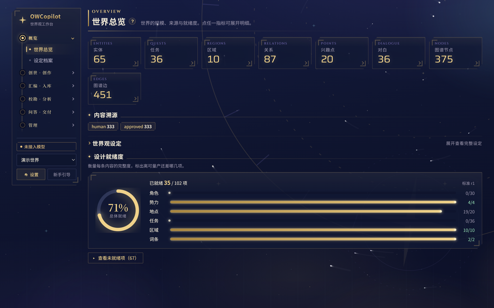

# OWCopilot

**A local-first AI workbench for game narrative production.**

Turn manuscripts, design tables, and digital PDFs into a traceable world model. Search lore, detect
continuity problems, analyze change impact, coordinate bounded agents, review proposals, and export
content to production-friendly formats from one workflow.

English | [简体中文](README.zh-CN.md)

**Traceable knowledge · consistency automation · controlled AI collaboration**

## Why OWCopilot

Large narrative projects spread world rules across scripts, spreadsheets, quest data, dialogue trees,
and reference documents. As the world grows, teams spend increasing time locating the latest fact,
checking downstream impact, and preventing contradictions between story, design, and engine data.

OWCopilot builds a common content layer around that workflow:

- preserve source locations and revisions during ingestion;
- combine lexical, semantic, and graph retrieval for cited answers;
- run deterministic checks for references, timelines, quest logic, and content integrity;
- let bounded agents investigate issues and prepare change proposals;
- coordinate specialized workers when a task benefits from decomposition;
- keep canonical changes behind review and export them to downstream tools.

## Core capabilities

| Area | What it provides | Main implementation |
|---|---|---|
| Content intake | DOCX, XLSX, Markdown, JSON/CSV, and digital PDF ingestion with stable hashes and source locators | [content](src/owcopilot/content/), [PDF intake](src/owcopilot/intake/) |
| RAG | Structure-aware and semantic chunking, BM25 + dense + graph retrieval, weighted RRF, neural reranking, token-bounded context, citations, and refusal | [retrieval](src/owcopilot/retrieval/) |
| Agent runtime | Bounded LangChain/LangGraph ReAct, typed tools, retries, deadlines, budgets, no-progress stops, checkpoints, and review pauses | [agent](src/owcopilot/agent/), [skills](src/owcopilot/skills/) |
| Memory | Checkpointed working state, episodic/reflection recall, and review-derived lesson memory with separate lifecycles | [episodic memory](src/owcopilot/agent/episodic.py), [reflection](src/owcopilot/agent/reflexion.py) |
| MCP | Local stdio server/client with tools, resources, prompts, discovery, and schema validation | [server](src/owcopilot/mcp_server/), [client](src/owcopilot/mcp_client/) |
| Multi-Agent | Orchestrator-worker-verifier graph, scoped assignments, SQLite blackboard, CAS claims, result synthesis, and independent verification | [multi-agent](src/owcopilot/multi_agent/) |
| Quality and trace | Deterministic audits, impact analysis, versioned evaluation suites, typed stop reasons, and OpenTelemetry spans | [audit](src/owcopilot/audit/), [evaluation](src/owcopilot/evaluation/) |
| Delivery | Web, CLI, REST/SSE, Unreal DataTable export, and Unity content import package | [web](apps/web/), [integrations](integrations/) |

## Quick start

Prerequisites: Git and Python 3.11 or 3.12. Node.js 22.12+ is needed only for the Web workbench.
The system smoke uses a deterministic offline model, so it runs without an API key or paid call.

~~~powershell
git clone https://github.com/Firefly0237/OWC-open-world-copilot.git
cd OWC-open-world-copilot
python -m venv .venv

# Windows PowerShell
.\.venv\Scripts\python -m pip install --upgrade pip
.\.venv\Scripts\python -m pip install -e ".[dev,serve,mcp,pdf,tokenizer]"

# Download only the revision-pinned bge-m3 tokenizer (not model weights), then prove it is usable
# without network access. model-revisions.json mirrors the manifest shipped in the Python package.
.\.venv\Scripts\python scripts\prefetch_models.py --component tokenizer
$env:HF_HUB_OFFLINE = "1"
$env:TRANSFORMERS_OFFLINE = "1"
.\.venv\Scripts\python scripts\prefetch_models.py --component tokenizer --offline

# Native tools
.\.venv\Scripts\python scripts\run_system_demo.py --transport native --artifact-root .tmp\system-demo

# The same audit through a local stdio MCP server/client
.\.venv\Scripts\python scripts\run_system_demo.py --transport mcp --artifact-root .tmp\system-demo
~~~

On macOS/Linux, replace <code>.\.venv\Scripts\python</code> with
<code>.venv/bin/python</code> and use <code>/</code> in paths.

A successful run ends with JSON containing:

~~~json
{
  "demo_status": "passed",
  "pdf_rag": {
    "citation_round_trip": true
  }
}
~~~

The command exercises the CLI, storage, checkpoints, memory, multi-agent graph, PDF-to-RAG citation
round trip, and the selected native or MCP tool route. Reference summaries are available in
[system demo results](benchmarks/evidence/system-demo/README.md).

The commands above are the clean-machine path. Continue with the [Web workbench README](apps/web/README.md)
for development and production-style browser runs, the [Team operator runbook](infra/team/README.md)
for PostgreSQL deployment, and [`.env.example`](.env.example) for explicit real-provider opt-in.

## Architecture

~~~mermaid
flowchart TD
    I["DOCX · XLSX · Markdown · digital PDF"] --> P["Ingest: bytes/hash + page/cell/paragraph locators"]
    P --> C["Canonical content: local files/SQLite team revision kernel: PostgreSQL"]
    P --> R["Retrieval units + parent links + provenance"]
    R --> H["BM25 + dense vectors + graph expansion"]
    H --> F["Weighted RRF + cross-encoder rerank + token budget"]
    F --> A["Cited QA / bounded ReAct agent"]
    M["Checkpoint state episodic/reflection + lesson memory"] <--> A
    X["MCP client ↔ stdio server tools · resources · prompts"] <--> A
    A --> Q{"Decomposition useful?"}
    Q -->|yes| MA["Orchestrator → scoped workers → verifier"]
    Q -->|no| D["Audit and impact analysis"]
    MA --> D
    C --> D
    D --> G["Cited answer or change proposal"]
    G --> V["Review gate"]
    V --> C
    A -. "budget · retry · stop reason · OTel" .-> T["Trace and evaluation"]
    MA -. "assignment · result · verdict" .-> T
~~~

## How the main workflow works

1. Intake preserves original hashes and paragraph, cell, page, line, or bounding-box locators.
2. Chunking follows document structure, then applies semantic boundaries inside safe structural regions.
3. BM25, dense vectors, and graph expansion generate candidates; weighted RRF and a cross-encoder rank them.
4. Context packing enforces a token budget and retains provenance for cited answers.
5. The Agent invokes typed native or MCP tools under retry, deadline, budget, and no-progress controls.
6. Complex tasks can fan out to scoped workers; a verifier reruns deterministic checks before synthesis.
7. Accepted proposals pass through review before canonical content and engine exports are updated.

## Engineering design

### Retrieval and chunking

Structural boundaries protect headings, tables, quest steps, dialogue turns, and citation locators.
Semantic similarity may merge or split content within those regions, which preserves local intent
without crossing known document structure. Hybrid retrieval starts from equal BM25/dense weights;
RRF normalizes rank-scale differences, and dev-set tuning selects candidate depth, fusion weights,
and reranking configuration before held-out evaluation.

### Agent, memory, and recovery

The Agent receives scoped read, analyze, and propose tools rather than unrestricted storage access.
Middleware classifies failures, retries transient errors with bounded backoff, enforces time and token
budgets, and stops repeated no-progress cycles. Checkpoints restore active workflow state; episodic
and reflection memory retrieve related runs by relevance, recency, and importance; approved review
feedback becomes revocable lessons.

### MCP and multi-agent coordination

Native tools and MCP tools share typed business handlers. The MCP layer adds protocol discovery,
resource and prompt access, input/output schema checks, and observable transport failures. For tasks
with separable subproblems, an orchestrator publishes scoped assignments to a blackboard, workers
claim them atomically, and a verifier checks outputs before synthesis. Simple tasks stay on the
single-Agent path.

Temporal-property authoring follows the same inspectable design: restricted translation,
closed-world flag grounding, deterministic assembly/type-checking, back-translation, and a separate
review transaction. The implementation and executable contract are in the
[authoring pipeline](src/owcopilot/spec_authoring/) and its [tests](tests/core/test_spec_authoring.py).

## Benchmarks and quality

| Benchmark | Dataset and method | Current result |
|---|---|---|
| [Retrieval](benchmarks/evaluation/reports/retrieval-report-v1.json) | 24 frozen document/query pairs; 12 dev + 12 held-out; bge-m3 and bge-reranker-v2-m3 | Held-out neural-reranker MRR, nDCG@5, and Recall@1: **1.0** |
| [Frozen ContextPack diagnostics](benchmarks/evaluation/reports/retrieval-diagnostics-v1.json) | 120 frozen queries; production ContextPack recall, FP2/FP3 budget attribution, and paired McNemar A/B; deterministic HashingEmbedder | **Mechanism verified** at `$0`; absolute rates are explicitly not a semantic-quality claim |
| [Chunking](benchmarks/evaluation/reports/chunking-report-v1.json) | 6 boundary-labelled documents; 3 dev + 3 held-out; structure and semantic strategies | Held-out balanced accuracy: **0.75** for both strategies |
| [Structural complexity](benchmarks/complexity_corpus.md) | Three profile-sampled narrative tiers through production audit, simulation, bounded exploration, and witness replay | All tiers: zero truncation and witness replay passed |
| [Formal suites](benchmarks/formal/) | Versioned contracts, controls, faults, hard-zero rules, and artifact verification | Executable suite and artifact validation definitions |

The two deterministic `$0` diagnostics reproduce without model downloads:

~~~powershell
.\.venv\Scripts\python scripts\run_frozen_retrieval_diagnostics.py
.\.venv\Scripts\python scripts\run_complexity_benchmark.py
~~~

Reproduce the retrieval and chunking reports with the semantic and tokenizer dependencies installed.
The first provisioning command downloads the revision-pinned embedding and reranker weights; it can
be several gigabytes and is deliberately excluded from Git. The second command proves the cache is
complete before an offline run.

~~~powershell
.\.venv\Scripts\python -m pip install -e ".[semantic,tokenizer]"
.\.venv\Scripts\python scripts\prefetch_models.py --component all
.\.venv\Scripts\python scripts\prefetch_models.py --component all --offline
.\.venv\Scripts\python scripts\eval_retrieval_benchmark.py --output .tmp\retrieval-report.json
.\.venv\Scripts\python scripts\eval_chunking_benchmark.py --output .tmp\chunking-report.json
.\.venv\Scripts\python scripts\run_formal_evals.py --output-dir .tmp\formal-evals
~~~

Real LLM calls are a separate opt-in: install `.[live]`, copy `.env.example` to `.env`, configure a
supported provider, set `OWCOPILOT_LLM_MODE=real`, and protect the service with `OWCOPILOT_API_KEY`.
Nothing in the default smoke, tests, or formal evaluator calls a paid provider.

## Run the web workbench

Node 22.12+ is required for the frontend. For development, run the API and Vite in separate
terminals; Vite proxies API requests to port 8000.

~~~powershell
.\.venv\Scripts\python -m uvicorn owcopilot.service.api:create_app --factory --port 8000
npm ci --prefix apps/web
npm run dev --prefix apps/web
# Open http://localhost:5173
~~~

For a production-style single port, run `npm run build --prefix apps/web`, restart the API, and open
<http://localhost:8000>; or use `docker compose up --build`. See the [Web README](apps/web/README.md).
The PostgreSQL-backed Team profile has a separate, fail-closed
[operator runbook](infra/team/README.md); it is not silently enabled by the local quick start.

Available interfaces:

- **Web** — intake, browse, audit, cited Q&A, Agent jobs, review, visualization, and export.
- **CLI** — machine-readable commands and non-zero failure exits for local automation.
- **REST/SSE** — resource-oriented APIs with asynchronous job progress.
- **MCP** — local tool interoperability for MCP-capable hosts and Agent consumers.

## Repository map

~~~text
apps/web/                    Vue 3 workbench
src/owcopilot/agent/         Agent runtime, middleware, and memory
src/owcopilot/retrieval/     chunking, indexes, fusion, reranking, context packing
src/owcopilot/mcp_server/    MCP server and shared tool handlers
src/owcopilot/mcp_client/    MCP consumer, validation, and Agent adapter
src/owcopilot/multi_agent/   orchestration, workers, blackboard, verifier
src/owcopilot/evaluation/    acceptance, task, reliability, and formal harnesses
benchmarks/evaluation/       frozen retrieval and chunking datasets and reports
benchmarks/formal/           versioned evaluation contracts and controls
scripts/                     system demos, evaluations, and quality gates
tests/                       backend and integration tests
infra/ · integrations/       deployment and engine adapters
~~~

## Development

~~~powershell
.\.venv\Scripts\python -m ruff check src tests scripts
.\.venv\Scripts\python -m mypy src/owcopilot
.\.venv\Scripts\python -m pytest -q
npm test --prefix apps/web
npm run build --prefix apps/web
~~~

On Windows, <code>pwsh ./scripts/ci_gate.ps1</code> runs the aggregate quality gate. GitHub Actions
covers Python 3.11/3.12, MCP compatibility, PostgreSQL migrations and RLS behavior, frontend tests,
and container smoke tests.

## Tech stack

Python 3.11+ · Pydantic v2 · FastAPI · LangChain/LangGraph · SQLite/FTS5/sqlite-vec ·
usearch HNSW · NetworkX · sentence-transformers · MCP Python SDK · PostgreSQL/Alembic ·
OpenTelemetry · Vue 3 · Vite · TypeScript

## License

Licensed under the [MIT License](LICENSE). Use
[GitHub Issues](https://github.com/Firefly0237/OWC-open-world-copilot/issues) for bugs and feature
requests. See [CONTRIBUTING.md](CONTRIBUTING.md), [SECURITY.md](SECURITY.md), and
[CHANGELOG.md](CHANGELOG.md) for the contribution, private-reporting, and release-history contracts.
