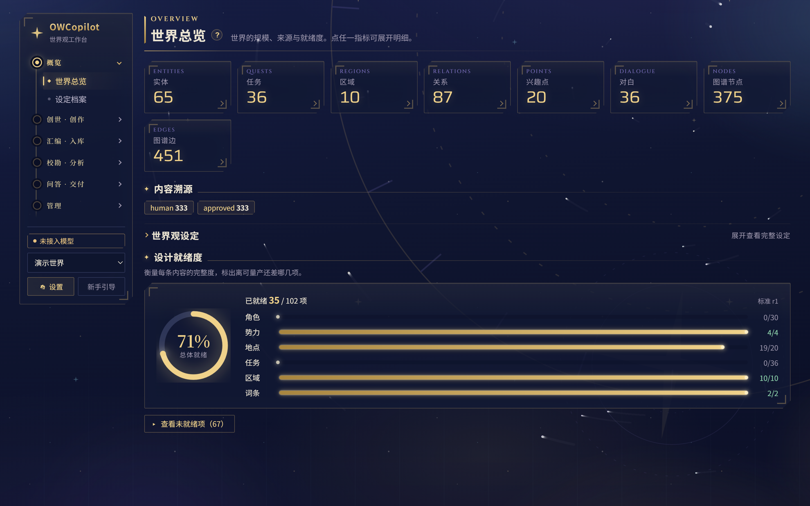

<div align="center">

# OWCopilot

**面向开放世界游戏叙事与世界观构建的本地优先 AI 工作台——
让庞大的世界观保持一致、可检索、随时可交付。**

[English](README.md) | 简体中文




</div>

## 功能特性

- 🗂️ **世界内容管理** — 势力、角色、地点、任务、事件与它们之间的关系，全部以普通文件存储，
  可用 git 做版本管理。支持从 JSON / CSV / XLSX（中文表头可识别）、Markdown 和整篇文稿导入。
- 🛡️ **一致性检查** — 引用完整性、时间线顺序、任务逻辑（死锁、不可达阶段、未定义变量）、
  对话条件、本地化预检等。每条问题都带定位与证据，点开即可修。
- 🕸️ **影响分析** — 改动一个势力、角色或事件之前，先看清会波及哪些任务、对话和区域。
- 🔮 **世界问答** — 既能查单个设定，也能问整个世界的格局，回答附带来源引用；世界里没有的
  内容会明确告诉你缺什么，而不是编一个。
- 🎭 **有据生成** — 从一句话生成世界初稿，或扩写区域、任务、角色、台词与对话树。生成内容
  只引用世界中已存在的实体，并经过自动评审打磨后进入审阅队列。
- ⚒️ **修复闭环** — 每个检出的问题都配有修复候选，一键应用、一键回滚。
- ✦ **可视化编辑** — 可拖拽的关系星图、时间线、对话流编辑器，以及世界版本间的快照对比。
- 📦 **交付导出** — 世界数据以带校验和的数据包导出，本地化输出 CSV / XLIFF 1.2；
  引擎侧改过的任务行可回传进入审阅。

## 快速开始

```bash
git clone <repo> && cd openworld
python -m venv .venv && .venv/Scripts/pip install -e ".[dev,serve]"   # Windows
# source .venv/bin/activate && pip install -e ".[dev,serve]"          # macOS/Linux
# 可选：".[semantic]" 启用多语言语义检索（首次会下载一次模型）

# 快速自检：构建内置的双语示例世界并跑完整质量门
.venv/Scripts/python -m owcopilot.cli.main eval-acceptance --workspace .tmp/demo
```

### 启动工作台

```bash
npm --prefix frontend install && npm --prefix frontend run build   # 仅首次
.venv/Scripts/python -m uvicorn owcopilot.service.api:create_app --factory --port 8000
# 打开 http://localhost:8000 —— 单进程；世界数据存放在 ~/.owcopilot/worlds/
```

首次启动有新手引导逐区讲解。如果你不熟悉命令行，请同事帮忙把上面的命令跑一次即可——
之后的所有操作都在浏览器里完成。

**首次运行是空的。** 通过「汇编 · 入库」导入你已有的素材（文稿、表格、Markdown），
或在「创世 · 创作」里从一句话生成初稿（需要先接入模型）。

**接入你自己的模型：** 打开「设置」，选择服务商（DeepSeek / OpenAI / Anthropic / Kimi /
智谱 / 通义 / 豆包 / 自定义），填入 API Key 并测试连接。Key 只保存在本地进程内存中、
直连服务商。浏览、检查、审阅、导出等功能不接入模型也能完整使用。

## 使用方式

- **Web 工作台** — 主要使用方式：创建、导入、检查、问答、审阅、导出都在浏览器里完成。
- **CLI** — `audit`、`impact`、`ask`、`draft` / `expand`、`export`、`eval-acceptance` 等；
  JSON 输出，有未解决错误时以非零码退出，可直接接入 CI。
- **REST API** — 按项目组织的资源化接口，长任务通过 SSE 推送进度。
- **MCP 服务** — 把诊断 / 检索 / 提议工具集暴露给 AI 助手和智能体框架使用。

## 工作原理

```
  已有素材 · 新想法 · 引擎侧改动
              ↓
  内容中枢 —— 结构化、有版本、可检索
              ↓
  质量层 —— 一致性校验 · 影响分析 · 时间线与任务逻辑检查
              ↓
  辅助层 —— 带引用的世界问答 · 有据初稿 · 修复建议
              ↓
  审阅 —— 通过、修改或退回；每次变更可追溯、可回滚
              ↓
  交付 —— 世界数据包 · 本地化文件 · 引擎回传
```

## 技术栈

Python 3.11+ · FastAPI · Pydantic v2 · NetworkX · SQLite (WAL) — Vue 3 · Vite · TypeScript，
可视化视图为手写的确定性 SVG。兼容任意 OpenAI 风格的 LLM 服务。

## 许可证

[MIT](LICENSE)
